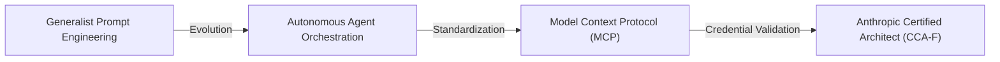
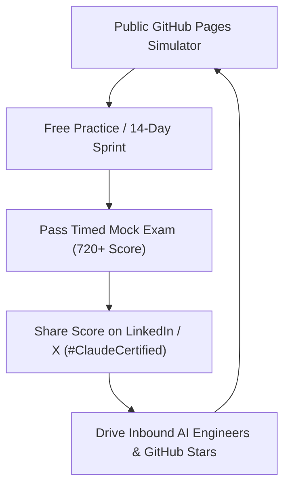

# 🚀 Anthropic CCA-F in 14 Days: The Zero-Cost Certification Blueprint

> **A Strategic Pitch Deck & Community Roadmap** to pass Anthropic's **Claude Certified Architect – Foundations (CCA-F / CCAR-F)** exam for **$0** in **under 20 hours of study**.

---

## 🧭 Executive Summary

Anthropic's **Claude Certified Architect (CCA-F)** has emerged as the premier technical credential for AI engineers building autonomous agents, Model Context Protocol (MCP) systems, and production LLM pipelines. 

However, **60–70% of candidates struggle on their first attempt** because the exam avoids memorization and tests **practical architectural judgment, failure recovery, and trade-off decisions**.

This project provides an open-source, zero-dependency, 702-question interactive simulator powered by spaced-repetition mastery — and this deck outlines how candidates can master the material, obtain a **100% free exam voucher** through the Claude Partner Network, and become certified within 2 weeks.

---

## 📊 Slide 1: Why the CCA-F Certification Matters



* **The Market Shift:** Companies no longer need basic chatbot wrappers; they need enterprise multi-agent workflows, tool schemas, and MCP integrations.
* **The Benchmark:** CCA-F is Pearson VUE proctored, scored on a rigorous 100–1000 scaled score (720 required to pass).
* **Target Audience:** AI Engineers, Solutions Architects, Technical Leads, and Full-Stack Developers transitioning into Agentic AI.

---

## ⏱️ Slide 2: How Long Does It Actually Take to Pass?

Based on candidate empirical data across 702 scenario drills, here is the realistic time commitment:

| Candidate Background | Recommended Study Time | Daily Commitment | Timeline |
| :--- | :---: | :---: | :---: |
| **Active AI / LLM Engineer** (Already uses Claude API & MCP) | **10 – 14 hours** | 1.5 hrs / day | **7 – 10 Days** |
| **Senior Software Architect** (New to Anthropic stack) | **18 – 24 hours** | 1.5 hrs / day | **14 – 16 Days** |
| **Junior Developer / Career Switcher** | **30 – 40 hours** | 1.5 – 2 hrs / day | **21 – 28 Days** |

### The 14-Day "Two Consecutive Passes" Sprint Schedule

```
Day 1–3:   Domain 1 (Agentic Architecture & Orchestration - 27% Weight)
Day 4–6:   Domain 2 (Claude Code & Developer Workflows - 20% Weight)
Day 7–8:   Domain 3 (Prompt Engineering & Structured Outputs - 20% Weight)
Day 9–10:  Domain 4 (Tool Design & Model Context Protocol / MCP - 18% Weight)
Day 11–12: Domain 5 (Context Management, Prompt Caching & Reliability - 15% Weight)
Day 13:    Full Timed Mock 1 & 2 (120 Mins each, aim for 800+ score)
Day 14:    Blitz Failed Questions Queue until 100% Cleared → Take Official Exam!
```

---

## 🧠 Slide 3: The Learning Engine (Why Questions Beat Reading)

Passive reading of API documentation leaves candidates blind to exam traps. The CCA-F tests **failure modes**:

1. **Active Recall via 702 Scenario Questions:** Every question presents an authentic production dilemma (e.g. infinite loop mitigation, prompt cache prefix invalidation, subagent context pollution).
2. **The "Two Consecutive Passes" Mastery Gate:** 
   * Miss a question once? It immediately drops to `Needs Practice (0/2)`.
   * The **Wise Feeder** re-surfaces it after an interval.
   * You must answer it correctly **2 consecutive times** across distinct sessions before it graduates to `Mastered (2/2)`.
3. **100% Client-Side Privacy:** All attempt histories, time-per-question metrics, and exam sessions are saved directly in your browser's `localStorage` — zero account creation, zero tracking, zero friction.

---

## 🎁 Slide 4: Sponsored Exam Vouchers (How Candidates Save $125 via Partner Channels)

> [!IMPORTANT]
> **Transparency Notice:** This study tool is an independent, 100% free community project. **We do not issue, sell, or distribute exam vouchers directly.** This guide explains the official partner sponsorship mechanism established by Anthropic.

### How Partner Exam Sponsorship Works:
1. **The Claude Partner Network (CPN):** Anthropic offers enterprise certification benefits to organizations registered in the Claude Partner Network. Partner organizations gain access to the **Anthropic Partner Academy**.
2. **Corporate & Remote Network Affiliations:** 
   * Many consulting agencies, system integrators, and remote talent networks (e.g. cloud consulting firms, remote engineering hubs) are enrolled CPN members.
   * If you work with, contract for, or contribute through a partner firm, you can request an organizational email alias (`@partner-domain.com`) from your administrator.
3. **Activating Subsidized / Free Registration:**
   * Sign into the **Anthropic Partner Academy** using your verified corporate partner email.
   * Eligible partner tiers receive subsidized registration (50% discounts or 100% fee waivers for premier tiers), dropping the Pearson VUE exam fee at checkout from **$125 to $0.00**.

---

## ⭐ Slide 5: The Star & Viral Growth Flywheel

To maximize community visibility, establish authority, and attract stars on GitHub:



### Viral Hooks Built Into the App:
* **"⭐ Star on GitHub" Header Button:** Persistent, non-intrusive badge directly in the app navigation.
* **Score Card Celebration:** Upon passing a 60-question mock, users receive an instant **"Share My Score on LinkedIn & X"** snippet and a celebratory prompt to star the repo.
* **Open Source Pride:** 100% free, MIT licensed, static hosting with zero paywalls.

---

## 🚀 Slide 6: Call to Action

1. **Explore the Live Simulator:** Hosted on GitHub Pages.
2. **Star the Repository:** Help us democratize AI engineering certifications!
3. **Join the Study Cohort:** Share your mock exam scores and join the discussions on GitHub.
